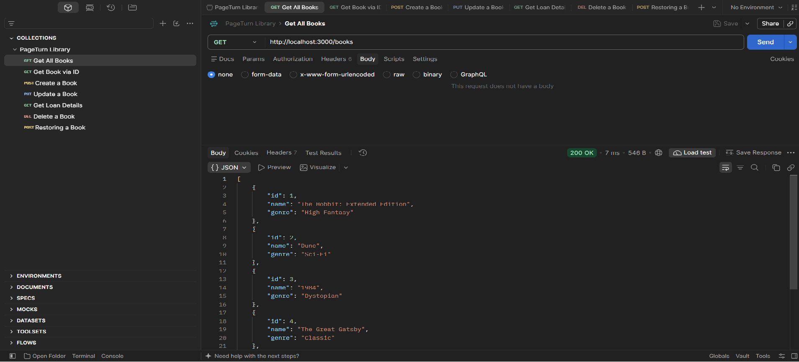
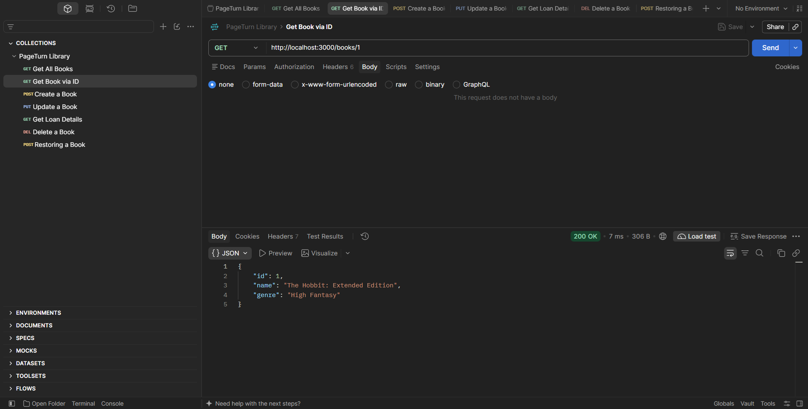
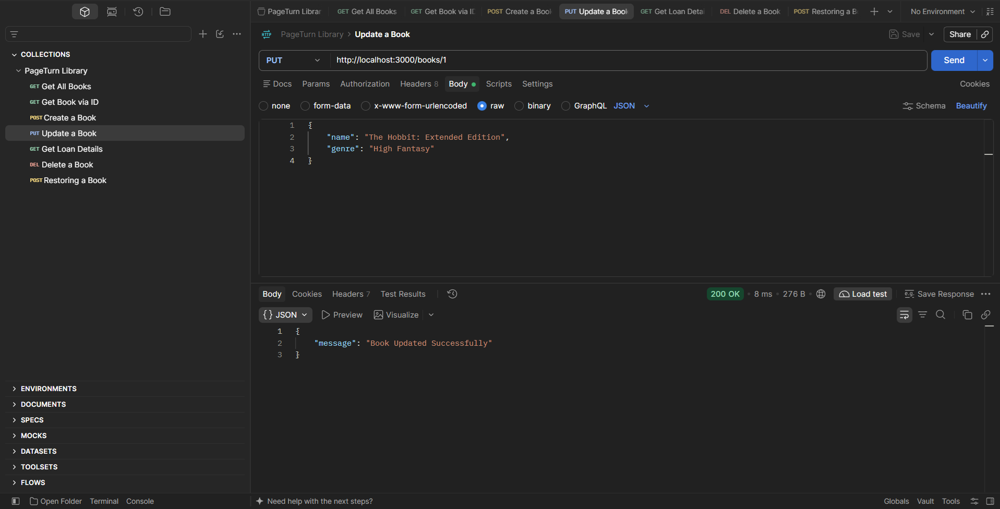
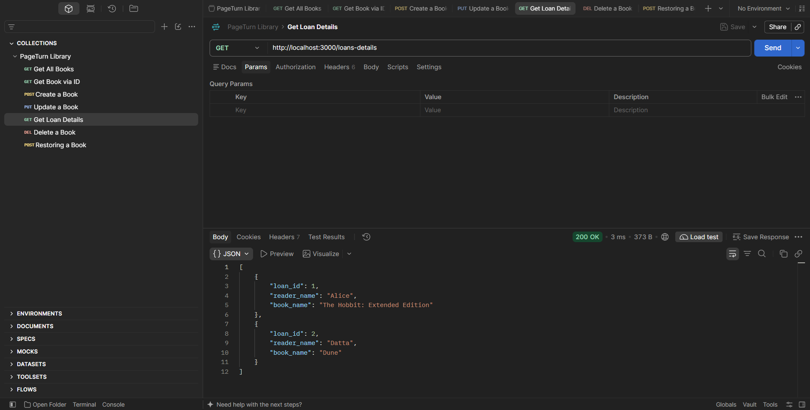
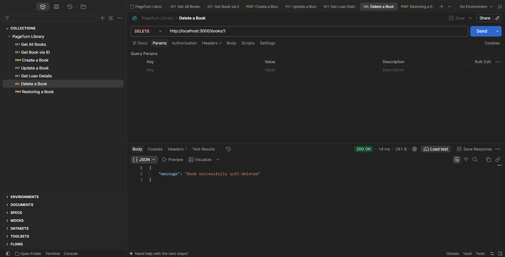
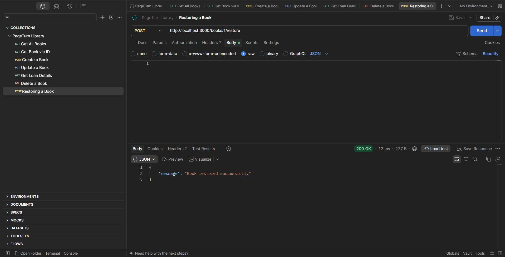

# PageTurn Library - Learning Group 02

**Theme:** Book lending
**Twist:** Soft delete and restore

## Team Members & Task Breakdown

| Name | Registration Number | Assigned Task | Role Size |
| :--- | :--- | :--- | :--- |
| Sadhu Jahnavi | 252U1R1222 | **Database & Server Setup:** Express init, SQLite tables (readers, books, loans) | Major |
| Sambu Bhavishya | 252U1R1224 | **Core REST Endpoints:** GET, POST, PUT, and the loans JOIN query | Major |
| Samala Ashwitha | 252U1R1223 | **Validation & Search:** Input validation (400 errors) and genre search query | Major |
| Sannikanti Venkata Datthathreya | 252U1R1226 | **Twist Logic:** Soft delete flag, hidden GET filter, and restore endpoint | Major |
| Sampath Uday Kumar | 252U1R1225 | **Testing & Docs:** Postman collection generation and README documentation | Major |

## Setup and Run
1. Install dependencies:
   ```bash
   npm install

## Postman API Testing Results

**1. Get All Books (GET)**


**2. Get Book via ID (GET)**


**3. Create a Book (POST)**


**4. Update a Book (PUT)**


**5. Get Loan Details (GET)**


**6. Delete a Book (DELETE - Twist)**


**7. Restoring a Book (POST - Twist)**
